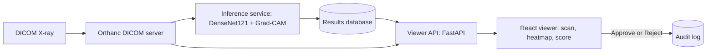

# AI-Assisted Medical Imaging and Diagnosis System (AIML-02)

**FOR EDUCATION ONLY. NOT FOR CLINICAL USE.**

A platform where a chest X-ray (DICOM) is stored on a DICOM server, analysed by a deep learning model, shown to a reviewer with an explanation heatmap, and approved or rejected, with every decision written to an audit log.

**Dataset:** RSNA Pneumonia Detection Challenge (Kaggle), a balanced subset of 600 patients.

## Architecture



## Tech stack
PyTorch, torchvision (DenseNet121), pydicom, Orthanc, Grad-CAM, FastAPI, React, Docker.

## What I built
1. Learned the DICOM format and read pixel data with pydicom.
2. Preprocessed images: percentile normalization and resize to 224x224.
3. Split patients into train, validation and test sets, stratified by label.
4. Trained a DenseNet121 classifier with transfer learning: only the last dense block and the new output layer were trained.
5. Added Grad-CAM, which shows the region that influenced each prediction (examples in `docs/gradcam/examples.png`).
6. Ran an Orthanc DICOM server in Docker and wrote an inference service that pulls new studies, scores them, and stores the heatmap.
7. Built a React viewer with the scan, the AI overlay, the confidence score and Approve/Reject buttons.
8. Logged every decision (reviewer, action, AI score, time) in an audit table.
9. Containerized Orthanc, the viewer and the inference service with Docker Compose.

### Measured results (test set, 120 images, threshold 0.5)
- AUC: 0.826 (95% bootstrap interval 0.743 to 0.889)
- Sensitivity (pneumonia caught): 0.833 (50 of 60)
- Specificity (normal kept): 0.650 (39 of 60)
- Confusion matrix [tn fp fn tp]: 39 21 10 50
These come from one small test set, so they carry wide uncertainty.


See `docs/model_card.md` for the full model card: limits and possible bias.

## Limits
- The model was trained on a small subset using a CPU, so it is far from clinical grade.
- Training classes were balanced 50/50, so precision in real use would be lower.
- Results come from one small test set and carry wide uncertainty.
- A segmentation model was not built because of time and CPU limits.
- Data versioning with DVC was not completed.
- The viewer has no login and Orthanc authentication is off: local demo only.
- The React page loads React from a CDN (no build step), so it needs internet.
- Grad-CAM shows where the model looked, not that it is correct.

## How to run it
```
python -m venv venv
venv\Scripts\activate
pip install torch torchvision pydicom pandas scikit-learn pillow matplotlib fastapi uvicorn requests
kaggle competitions download -c rsna-pneumonia-detection-challenge -f stage_2_train_labels.csv -p data
```
Run `01_subset.ipynb` (download and preprocess), then `02_train.ipynb` (train, test, Grad-CAM). Then:
```
docker compose -f docker\docker-compose.yml up -d
```
Upload studies to Orthanc at http://localhost:8042, then open the viewer at http://localhost:8001.
